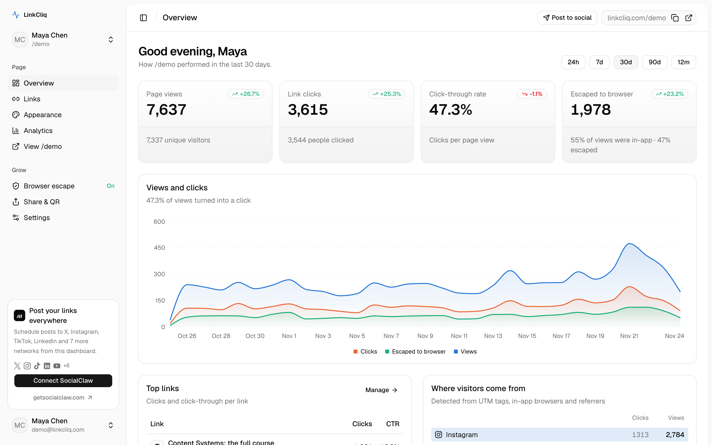
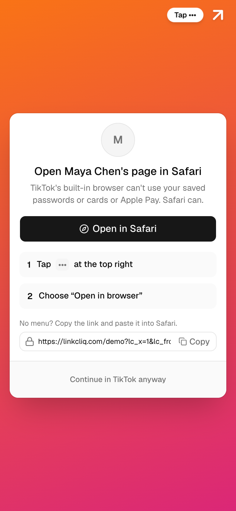
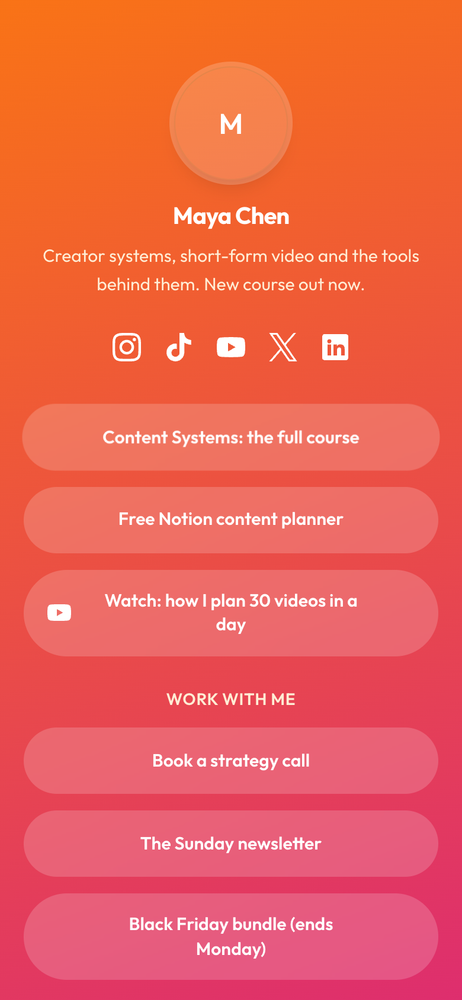
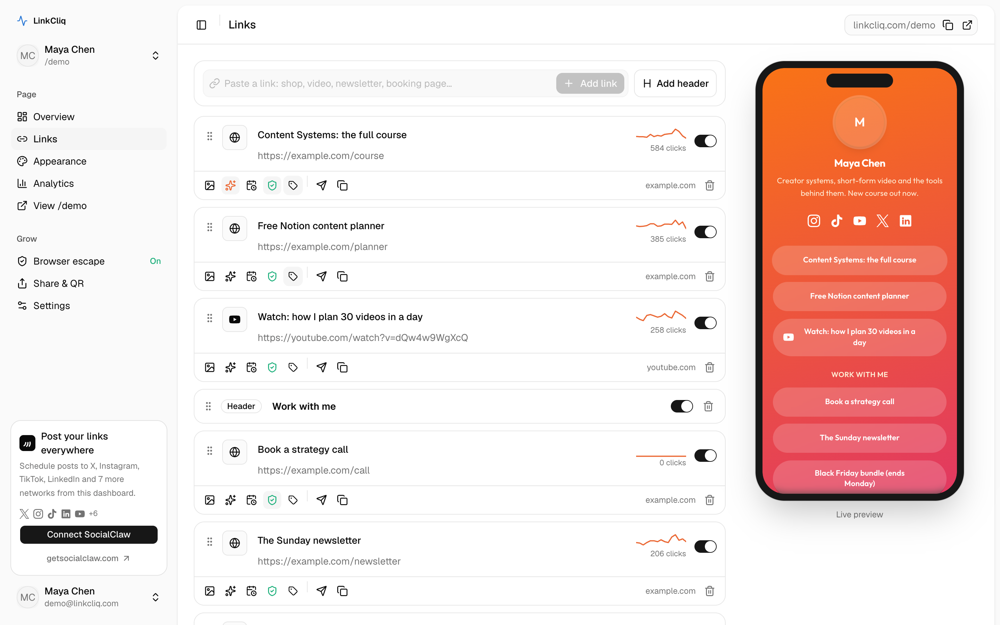
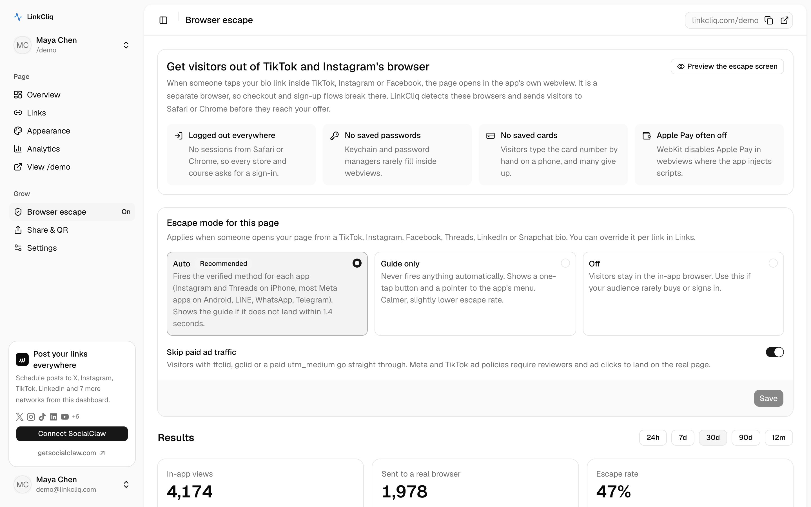

<div align="center">


# LinkCliq

**The open source link in bio that gets buyers out of TikTok's browser.**

A free link in bio page with real click analytics and a browser escape that moves TikTok, Instagram and Facebook visitors to Safari or Chrome, where they are signed in and their card fills itself. Use it free at **[linkcliq.com](https://linkcliq.com)** or run it on your own server.

[linkcliq.com](https://linkcliq.com) · [Self-host](#self-host) · [How browser escape works](#how-browser-escape-works) · [Research notes](docs/research/in-app-browser-escape.md) · [Contributing](#contributing)


</div>

<picture>
  <source media="(prefers-color-scheme: dark)" srcset="docs/screenshots/overview-dark.png" />
  
</picture>

## Why this exists

Tap a link in TikTok or Instagram and it opens in the app's built-in browser. That browser shares nothing with Safari or Chrome:

- **Signed out of everything.** Every store, course platform and community asks for a login again.
- **No saved passwords or cards.** Autofill rarely works, so people type a card number by hand on a phone, and many give up.
- **Apple Pay often off.** WebKit disables payment APIs in webviews where the host app injects scripts ([WebKit commit](https://webkit.googlesource.com/WebKit/+/cb7795624b45af5743b20b3e4e4c0860f1efca17)).
- **Injected tracking.** Several apps run their own JavaScript on every page you open ([Felix Krause, 2022](https://krausefx.com/blog/announcing-inappbrowsercom-see-what-javascript-commands-get-executed-in-an-in-app-browser)).

If you sell anything from a bio link, this is the leakiest step of your funnel. Escape tools charge $9 to $36 a month to fix it. LinkCliq does it for free, in the open, on your own domain.

## Features

### Browser escape

- Recognizes 16 in-app browsers: TikTok, Instagram, Threads, Facebook, Messenger, X, LinkedIn, Snapchat, Pinterest, Reddit, Telegram, WhatsApp, LINE, WeChat, Discord and the Google app.
- Three modes per page (**Auto**, **Guide only**, **Off**) with a per-link override.
- Auto only fires methods with a published, device-tested result. Everything else gets a one-tap button and a guide that points at the app's own menu.
- One attempt, then the guide after 1.4 seconds if the visitor is still in the app. No chains of redirects, and "Continue anyway" is always there.
- Paid ad traffic (`ttclid`, `gclid`, a paid `utm_medium` and friends) skips the escape by default, so ad reviewers and ad clicks land on the real page.
- Every escape is measured: in-app views, escapes by app and by method, escape rate over time.

### Link in bio

- Links, section headers and 34 social icons, reordered by drag and drop.
- 8 themes plus full control of background, buttons, colors and 7 fonts.
- Scheduled links with start and end dates, thumbnails, and pulse, wobble or glow highlights.
- Sensitive content gate, SEO title and description, optional GA4 and Meta Pixel.
- Several pages per account, with a live phone preview while you edit.

### Analytics

- Views, unique visitors, clicks and click-through rate, compared with the previous period.
- Sources from UTM tags, the in-app browser and the referrer. A visit from TikTok's browser counts as TikTok even when TikTok sends no referrer.
- Countries, devices, browsers, operating systems and a sparkline per link.
- UTM passthrough: the destination receives `utm_source=tiktok`, so your store's analytics see the real source too.
- Bots and link preview crawlers filtered out. CSV export.

### Share

- QR codes as PNG or SVG, and a tracked link per channel.

### For instance owners

- An admin view to search every page and suspend the ones that break your rules.
- Password reset emails through [Resend](https://resend.com), and accounts that can delete themselves and everything they own.
- Country analytics without a CDN, using the bundled DB-IP Lite database.

### Post to social (optional)

Paste a [SocialClaw](https://getsocialclaw.com/?utm_source=linkcliq&utm_medium=oss&utm_campaign=readme) API key to schedule posts with your links to X, Instagram, TikTok, LinkedIn and 7 more networks from the dashboard. LinkCliq works fully without it.

<table>
  <tr>
    <td width="33%"></td>
    <td width="33%"></td>
    <td width="33%">
      <picture>
        <source media="(prefers-color-scheme: dark)" srcset="docs/screenshots/links-dark.png" />
        
      </picture>
      <br /><br />
      <picture>
        <source media="(prefers-color-scheme: dark)" srcset="docs/screenshots/escape-dark.png" />
        
      </picture>
    </td>
  </tr>
</table>

## How browser escape works

1. A visitor opens your page from a bio. LinkCliq reads the user agent and works out the app and the operating system.
2. If that app has a verified escape route, it fires once. On an iPhone in Instagram that is `instagram://extbrowser`; in Facebook on Android it is an `intent://` link with a browser fallback.
3. If there is no verified route, or the visitor is still in the app after 1.4 seconds, they see a short guide: a one-tap button, the exact menu to open, and a copy link field.
4. The page that loads in Safari or Chrome is tagged, so LinkCliq counts it as an escape and never as a second view.

The whole page escapes once, so every link the visitor taps afterwards opens in the real browser. Links shared on their own (in DMs, for example) can escape individually through `/go/<id>`.

| App | iPhone | Android |
| --- | --- | --- |
| TikTok | One tap: `x-safari-https` | One tap: Android intent |
| Instagram | Automatic: `instagram://extbrowser` | Automatic: Android intent |
| Threads | Automatic: `barcelona://extbrowser` | Automatic: Android intent |
| Facebook | One tap: `x-safari-https` | Automatic: Android intent |
| Messenger | One tap: `x-safari-https` | Automatic: Android intent |
| X | One tap: `x-safari-https` | Not needed (opens a Chrome tab) |
| LinkedIn | One tap: `x-safari-https` | Not needed (opens a Chrome tab) |
| Snapchat | Guide only | Not needed (opens a Chrome tab) |
| Reddit | Guide only | One tap: Android intent |
| Telegram | Automatic: `x-safari-https` | Automatic: Android intent |
| WhatsApp | Automatic: `x-safari-https` | One tap: Android intent |
| LINE | Automatic: `openExternalBrowser=1` | Automatic: `openExternalBrowser=1` |
| WeChat | Guide only | Guide only |
| Pinterest | Guide only | One tap: Android intent |
| Discord | Guide only | One tap: Android intent |

The table is generated from [`src/lib/escape.ts`](src/lib/escape.ts). None of these schemes are documented by the apps and any update can break one, which is why LinkCliq measures escapes per method instead of assuming they work. The [research notes](docs/research/in-app-browser-escape.md) cover each method, its sources, TikTok's link rules and the ad policy questions.

**Found a method that stopped working, or one that works where the table says "guide"?** Please [open an issue](#contributing) with the app, app version and OS version.

## Self-host

```bash
curl -O https://raw.githubusercontent.com/ndesv21/linkcliq/main/docker-compose.yml
docker compose up -d
```

Open [localhost:3000](http://localhost:3000) and create your account. The image is published for amd64 and arm64 at `ghcr.io/ndesv21/linkcliq`, the database is a SQLite file in the `linkcliq-data` volume, and migrations run on boot.

The **[self-hosting guide](docs/self-hosting.md)** covers putting it on your own domain with HTTPS, Railway, plain Node, Vercel with Turso, password reset emails, moderation, backups and upgrades.

## Privacy

LinkCliq sets no cookies on public pages and never stores IP addresses. Unique visitors are counted with a hash of the IP and user agent that is salted per page and rotates every day, so a visitor cannot be followed across days or pages. Each event stores the time, page, link, source, referrer domain, country (from your CDN's header, or looked up locally in the bundled [DB-IP Lite](https://db-ip.com) database), device type, browser, OS and UTM tags.

## Development

```bash
npm install
npm run seed     # optional: demo account with 120 days of traffic
npm run dev
```

The seed creates `demo@linkcliq.com` with the password `linkcliq-demo`.

| Command | |
| --- | --- |
| `npm run db:generate` | Create a migration after changing `src/lib/db/schema.ts` |
| `npm run db:migrate` | Apply migrations without starting the app |
| `npm run db:studio` | Browse the database |
| `npm run gen:platforms` | Regenerate social icons from simple-icons |

**Stack:** Next.js 16 (App Router), React 19, [shadcn/ui](https://ui.shadcn.com) on Radix, Tailwind CSS 4, Recharts, Drizzle ORM with SQLite or libSQL, Better Auth, [inapp-spy](https://github.com/shalanah/inapp-spy) for in-app browser detection.

```
src/app/[handle]        public bio page and page-level escape
src/app/go/[id]         click tracking and link-level escape
src/app/o/[id]          escape screen for a single link
src/app/dashboard       the dashboard
src/lib/escape.ts       escape methods per app and OS
src/lib/in-app.ts       in-app browser detection
src/lib/analytics.ts    every dashboard query
```

## Contributing

Issues and pull requests are welcome. Reports from real devices are the most useful thing you can send: if an escape method fails or works differently from the table above, open an issue with the app name and version, the OS version, and what happened.

## License

[MIT](LICENSE). Built by the team behind [SocialClaw](https://getsocialclaw.com/?utm_source=linkcliq&utm_medium=oss&utm_campaign=readme).
